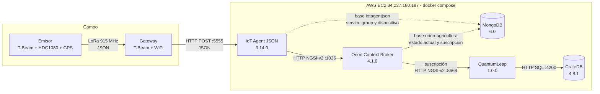

# Nube: plataforma FIWARE en AWS EC2

Esta carpeta documenta la parte del sistema que **no** es firmware: los
servicios que corren en la EC2 con Docker Compose y que reciben, guardan e
historizan las medidas que manda el gateway.

Lo que se describe aquí se verificó contra la EC2 el 2026-10-21 con
[`recolectar_info.sh`](recolectar_info.sh). Lo que todavía falta confirmar está
marcado con ⏳ **PENDIENTE**.

| Archivo | Para qué sirve |
|---|---|
| `README.md` | Esta documentación |
| [`docker-compose.yml`](docker-compose.yml) | Definición de los 5 servicios. Es la copia de `~/fiware/docker-compose.yml`. |
| [`provisionamiento.sh`](provisionamiento.sh) | Crea el service group, el dispositivo y la suscripción. Solo hace falta para montar la plataforma desde cero. |
| [`recolectar_info.sh`](recolectar_info.sh) | Script de solo lectura que vuelca la configuración y el estado de la EC2 |

---

## 1. ¿Qué tenemos?

### Vista general



### Componentes

| Componente | Imagen / versión | Qué es | Documentación |
|---|---|---|---|
| Emisor | firmware propio ([src/emisor](../src/emisor/main.cpp)) | Mide temperatura, humedad y posición GPS cada 10 s y lo transmite por LoRa | — |
| Gateway | firmware propio ([src/gateway](../src/gateway/main.cpp)) | Recibe por LoRa y reenvía por HTTP a la nube, con cola de reintentos | — |
| IoT Agent JSON | `quay.io/fiware/iotagent-json:3.14.0-distroless` (usa iotagent-node-lib 4.14.0) | Traduce el JSON del dispositivo a entidades NGSI-v2 de Orion | [IoT Agent JSON](https://fiware-iotagent-json.readthedocs.io/) · [iotagent-node-lib](https://iotagent-node-lib.readthedocs.io/) |
| Orion Context Broker | `quay.io/fiware/orion:4.1.0` | Guarda el **estado actual** de cada entidad y avisa a los suscriptores cuando cambia | [Orion 4.1.0](https://fiware-orion.rtfd.io/en/4.1.0/) · [especificación NGSI-v2](https://fiware.github.io/specifications/ngsiv2/stable/) |
| MongoDB | `mongo:6.0` | Base de datos de Orion y del IoT Agent | [MongoDB 6.0](https://www.mongodb.com/docs/v6.0/) |
| QuantumLeap | `orchestracities/quantumleap:1.0.0` | Recibe las notificaciones de Orion y guarda cada cambio como una serie de tiempo | [QuantumLeap](https://quantumleap.readthedocs.io/) |
| CrateDB | `crate:4.8.1` | Base de datos SQL donde QuantumLeap guarda el **histórico** | [CrateDB 4.8](https://cratedb.com/docs/crate/reference/en/4.8/) |

### Infraestructura

| Elemento | Valor |
|---|---|
| Proveedor | AWS EC2 (AWS Academy Learner Lab), Ubuntu |
| IP pública | `34.237.180.187`. No cambió al detener y volver a iniciar la instancia, así que se comporta como una Elastic IP. |
| Acceso SSH | Usuario `ubuntu`, par de claves `vockey` (`labsuser.pem`), o EC2 Instance Connect desde la consola |
| Carpeta del compose | `~/fiware` (solo contiene `docker-compose.yml`) |
| Docker | Engine 29.9.1, Compose v5.6.0. Se usa `docker compose`, con espacio. |
| Arranque automático | Sí. El servicio `docker` está `enabled` y los 5 contenedores tienen `restart: unless-stopped`, así que al iniciar la EC2 todo se levanta solo. |
| Persistencia | Volúmenes `fiware_mongo-db` y `fiware_crate-db`. Los datos sobreviven a reinicios y a `docker compose down`, pero **no** a `docker compose down -v`. |
| Visualización | Consola web de CrateDB (`http://34.237.180.187:4200`), consultando con SQL la tabla `mtagricultura.etsensoragricola` |

### Puertos

Un puerto es alcanzable desde Internet solo si cumple dos condiciones: Docker
lo publica en la EC2 y el Security Group lo permite.

| Puerto | Servicio | Publicado por Docker | Abierto en el Security Group | Para qué |
|---|---|---|---|---|
| 22 | SSH (la EC2) | — | Sí, `0.0.0.0/0` | Administración: SSH y EC2 Instance Connect |
| 5555 | IoT Agent | Sí | Sí, `0.0.0.0/0` | **Southbound**: entrada HTTP de medidas desde el gateway (`IOTA_HTTP_PORT`) |
| 4200 | CrateDB | Sí | Solo `200.3.144.141/32` | API HTTP/SQL y consola web, donde se visualizan los datos |
| 4041 | IoT Agent | Sí | **No** | **Northbound**: API de administración, para crear service groups y dispositivos (`IOTA_NORTH_PORT`) |
| 1026 | Orion | Sí | **No** | API NGSI-v2: consultar y modificar entidades, crear suscripciones |
| 7896 | IoT Agent | No | No | Puerto HTTP por defecto de la imagen. No se usa porque se cambió a 5555. |
| 27017 | MongoDB | No | No | Solo accesible dentro de la red `fiware_default` |
| 8668 | QuantumLeap | No | No | Recibe notificaciones de Orion. Su API de consulta del histórico solo es accesible dentro de Docker. |
| 4300 / 5432 | CrateDB | No | No | Comunicación entre nodos / protocolo PostgreSQL |

Security Group `sg-0da85f7226698e695` (`launch-wizard-6`), reglas de entrada
consultadas el 2026-10-21. La instancia no tiene rol de IAM.

---

## 2. ¿Cómo funciona?

### Identificadores

| Concepto | Valor | Dónde se define |
|---|---|---|
| Device id | `461879` | `DEVICE_ID` del emisor. Viaja en la URL como `i=461879`. |
| Apikey | (secreta) | Service group del agente y `AGENTE_APIKEY` en `include/secrets.h`. Viaja en la URL como `k=...`. |
| Servicio (`fiware-service`) | `agricultura` | Service group. Separa los datos por "inquilino": Orion arranca con `-multiservice` y por eso usa la base `orion-agricultura`. |
| Subservicio (`fiware-servicepath`) | `/` | Service group |
| Tipo de entidad | `SensorAgricola` | Service group y dispositivo |
| Id de entidad | `urn:ngsi-ld:SensorAgricola:461879` | Dispositivo (`entity_name`) |

### Recorrido de una medida

#### a) Emisor → Gateway: LoRa

- **Protocolo:** LoRa punto a punto (no LoRaWAN), con la librería
  [arduino-LoRa](https://github.com/sandeepmistry/arduino-LoRa). Los parámetros
  son comunes a las dos placas y están en [radio_config.h](../include/radio_config.h):
  915 MHz, BW 125 kHz, SF9, CR 4/5, sync word `0x5A` y CRC activado.
- **Por qué LoRa:** largo alcance y bajo consumo en campo, donde no hay WiFi.
  A cambio, el ancho de banda es bajo: máximo 255 bytes por paquete.
- **Formato:** JSON compacto de una línea.
  ```json
  {"id":"461879","n":12,"t":22.41,"h":61.30,"lat":6.245259,"lon":-75.596510}
  ```
  Un dato inválido (sensor ausente o GPS sin fix) viaja como `null`, nunca
  como `0`.

#### b) Gateway → IoT Agent: HTTP

- **Protocolo:** HTTP/1.1, `POST` sin TLS, al puerto southbound 5555, en la
  ruta `/iot/json` (`IOTA_DEFAULT_RESOURCE`).
- **Por qué HTTP:** el IoT Agent JSON acepta HTTP, MQTT y AMQP. En el compose
  MQTT y AMQP están desactivados (`IOTA_MQTT_DISABLED`, `IOTA_AMQP_DISABLED`),
  así que no hace falta un broker MQTT. Además el ESP32 trae `HTTPClient`.
- **Formato:** el gateway saca el `id` del JSON y lo pone en la URL. El cuerpo
  lleva el resto de campos más la calidad de la señal LoRa.
  ```
  POST http://34.237.180.187:5555/iot/json?k=<apikey>&i=461879
  Content-Type: application/json

  {"n":12,"t":22.41,"h":61.30,"lat":6.245259,"lon":-75.596510,"rssi":-87,"snr":9.5}
  ```
- **Respuesta:** un código `2xx` saca la trama de la cola del gateway. Un
  `4xx` la descarta, porque reenviarla daría el mismo error. Un error de red o
  un `5xx` la reintenta cada 5 s.

#### c) IoT Agent → Orion: NGSI-v2

1. El agente busca el **service group** por la apikey y la ruta. De ahí saca
   el servicio `agricultura`, el subservicio `/` y el tipo `SensorAgricola`.
2. Busca el **dispositivo** `461879`, que tiene el mapeo de campos cortos a
   nombres de atributo:

   | Campo en la trama | Atributo NGSI | Tipo NGSI | Columna en CrateDB |
   |---|---|---|---|
   | `n` | `numeroTrama` | `Integer` | `numerotrama` (bigint) |
   | `t` | `temperatura` | `Number` | `temperatura` (real) |
   | `h` | `humedad` | `Number` | `humedad` (real) |
   | `lat` | `latitud` | `Number` | — (ver nota) |
   | `lon` | `longitud` | `Number` | — (ver nota) |
   | `rssi` | `rssi` | `Integer` | `rssi` (bigint) |
   | `snr` | `snr` | `Number` | `snr` (real) |
   | (lo agrega el agente) | `TimeInstant` | `DateTime` | `timeinstant` |

   `IOTA_AUTOCAST=true` hace que los valores viajen como números y no como
   texto. `IOTA_TIMESTAMP=true` hace que el agente agregue `TimeInstant` con
   la hora de llegada.
3. Envía la actualización a Orion (`IOTA_CB_HOST=orion`, puerto 1026, NGSI-v2)
   con los encabezados `fiware-service: agricultura` y
   `fiware-servicepath: /`.

**Formato** de la entidad en Orion (NGSI-v2, formato normalizado):

```json
{
  "id": "urn:ngsi-ld:SensorAgricola:461879",
  "type": "SensorAgricola",
  "numeroTrama": {"type": "Integer", "value": 579, "metadata": {"TimeInstant": {"type": "DateTime", "value": "2026-10-16T20:50:01.836Z"}}},
  "temperatura": {"type": "Number",  "value": 23.61, "metadata": {...}},
  "humedad":     {"type": "Number",  "value": 76.32, "metadata": {...}},
  "rssi":        {"type": "Integer", "value": -54,   "metadata": {...}},
  "snr":         {"type": "Number",  "value": 10,    "metadata": {...}},
  "TimeInstant": {"type": "DateTime", "value": "2026-10-16T20:50:01.836Z"}
}
```

> **Nota sobre `latitud` y `longitud`:** la entidad y la tabla de CrateDB no
> tienen esos atributos. En las 525 medidas guardadas hasta el 2026-10-21,
> `lat` y `lon` llegaron siempre como `null` (GPS sin fix). Un atributo NGSI
> solo se crea la primera vez que llega con un valor real, así que aparecerán
> cuando el GPS tenga fix.

#### ¿Se destruye la entidad en cada envío? No.

Esto fue lo que cuestionó el docente. **Ojo con la confusión:** el `POST` del
que se habló en clase es el del **gateway al agente**, no el del agente a
Orion. El segundo lo hace el IoT Agent de FIWARE, que no es código del
proyecto.

En NGSI-v2 ningún `POST` borra entidades: o la crean, o crean y actualizan
atributos. Lo que sí reemplaza todos los atributos es
`PUT /v2/entities/{id}/attrs` o `actionType: "replace"`, y borrar es `DELETE`.

**Evidencia** tomada de MongoDB y de las notificaciones que recibió QuantumLeap:

| Momento | `numeroTrama` | `dateCreated` | `dateModified` |
|---|---|---|---|
| Notificación del 2026-10-16 | 540 | `2026-10-16T18:18:41.912Z` | `2026-10-16T20:43:31.895Z` |
| Notificación del 2026-10-16 | 541 | `2026-10-16T18:18:41.912Z` | `2026-10-16T20:43:41.942Z` |
| Estado final en Mongo | 579 | `2026-10-16T18:18:41.912Z` | `2026-10-16T20:50:01.840Z` |

La **fecha de creación es siempre la misma** (la de la primera medida, a las
18:18:41), mientras que la de modificación avanza con cada trama. Si la
entidad se borrara y se volviera a crear, `dateCreated` cambiaría en cada
envío.

Para repetir la comprobación en vivo:

```bash
curl -s "http://localhost:1026/v2/entities/urn:ngsi-ld:SensorAgricola:461879?attrs=dateCreated,dateModified,*" \
  -H "fiware-service: agricultura" -H "fiware-servicepath: /"
```

**Método que usa el agente: `POST /v2/entities?options=upsert`.** Así consta
en el log de Orion, que registra cada petición recibida. Esta es la última
medida guardada (`172.18.0.6` es el contenedor del agente):

```
time=2026-10-16T20:50:01.841Z | from=172.18.0.6 | srv=agricultura | subsrv=/ |
msg=Request received: POST /v2/entities?options=upsert, request payload (751 bytes):
{"id":"urn:ngsi-ld:SensorAgricola:461879","type":"SensorAgricola",
 "numeroTrama":{"type":"Integer","value":579,...},"temperatura":{...},
 "humedad":{...},"rssi":{...},"snr":{...},"TimeInstant":{...}},
response code: 204
```

Según la [especificación NGSI-v2](https://fiware.github.io/specifications/ngsiv2/stable/),
`options=upsert` significa lo siguiente:

- Si la entidad **no existe**, la crea y responde `201 Created`.
- Si **ya existe**, la actualiza: agrega o modifica los atributos que vengan
  en la petición y deja los demás como estaban. Responde `204 No Content`.

Todas las medidas responden **204**, es decir, son actualizaciones y no
creaciones. Solo la primera medida, la del 2026-10-16 a las 18:18:41, creó la
entidad. Esto coincide con que `dateCreated` no cambie.

Además, en el cuerpo no vienen `latitud` ni `longitud`: el agente omite los
campos que llegan como `null`.

Para repetir la consulta en la EC2:

```bash
cd ~/fiware
docker compose logs --no-color orion | grep "Request received" | grep -v " GET " | tail -5
```

#### d) Orion → QuantumLeap → CrateDB: el histórico

Orion solo guarda el **último valor** de cada atributo, porque es un broker de
contexto y no una base de datos histórica. Para tener el histórico hay una
**suscripción** en Orion:

| Campo | Valor |
|---|---|
| Descripción | `Historico a QuantumLeap` |
| Entidades | Todas las de tipo `SensorAgricola` (`idPattern: ".*"`) |
| Atributos | Todos (`attrs: []`), sin condición: notifica en cualquier cambio |
| Destino | `POST http://quantumleap:8668/v2/notify`, dentro de la red de Docker |
| Formato | `normalized`, con metadatos `dateCreated` y `dateModified` |
| Estado (2026-10-21) | `active`, 525 notificaciones, 0 fallos, último código 200 |

QuantumLeap convierte cada notificación en una **fila nueva** de CrateDB:

- **Esquema y tabla:** `"mtagricultura"."etsensoragricola"`. El esquema es
  `mt` + servicio y la tabla es `et` + tipo de entidad.
- **Columnas:** `entity_id`, `entity_type`, `time_index` (marca de tiempo de la
  fila, tomada de `TimeInstant`), `fiware_servicepath`, `instanceid` (id único
  de la fila), un campo por atributo (`numerotrama`, `temperatura`, `humedad`,
  `rssi`, `snr`) y `timeinstant`.
- **Contenido al 2026-10-21:** 525 filas, del 2026-10-16 18:18 al 20:50 UTC.

Consulta de ejemplo desde la EC2:

```bash
curl -s -X POST localhost:4200/_sql -H "Content-Type: application/json" -d '{"stmt":
  "SELECT time_index, numerotrama, temperatura, humedad, rssi, snr FROM mtagricultura.etsensoragricola ORDER BY time_index DESC LIMIT 10"}'
```

También se puede usar la consola web de CrateDB en `http://34.237.180.187:4200`.

### Qué almacena cada servicio

| Servicio | Dónde | Qué guarda |
|---|---|---|
| IoT Agent | MongoDB, base `iotagentjson`, colecciones `groups`, `devices` y `commands` | Service group, dispositivo con su mapeo de atributos y la última medida recibida (`oldCtxt`) |
| Orion | MongoDB, base `orion-agricultura`, colecciones `entities` y `csubs` | Estado actual de la entidad (1 documento) y la suscripción |
| QuantumLeap | CrateDB, tabla `mtagricultura.etsensoragricola` | Histórico: una fila por cada notificación |
| Gateway | RAM de la placa | Cola circular de 20 tramas cuando no hay red. Se pierde si la placa se reinicia. |

### Chequeos de salud

Orion y el IoT Agent traen un *healthcheck* en la imagen. Por eso
`docker compose ps` dice `(healthy)` y en los logs aparece cada 30-60 s una
petición a `/iot/about` o `GET /v2/entities?limit=1`. Eso **no** es tráfico
del gateway.

---

## Seguridad

### Requisito del docente

> El sensor no debe poder escribir directamente en Orion sin pasar por el
> agente.

**Se cumple con el Security Group.** Desde Internet solo están abiertos el
5555, que es el IoT Agent, y el 22, que es SSH. El 1026 de Orion y el 4041 de
administración del agente están cerrados. Así, lo único que puede hacer un
dispositivo desde fuera es mandar medidas al agente, y es el agente, dentro de
la red de Docker, quien escribe en Orion.

```
gateway --:5555--> IoT Agent --(red interna de Docker)--> Orion :1026
gateway --:1026--> Orion        bloqueado por el Security Group
```

El emisor ni siquiera tiene conexión a Internet: solo habla LoRa con el
gateway. El único equipo de campo que llega a la nube es el gateway, y solo
conoce la URL del agente.

Para comprobarlo desde cualquier equipo fuera de la EC2, por ejemplo el PC:

```bash
curl -s -m 5 http://34.237.180.187:1026/version   || echo "Orion: bloqueado (correcto)"
curl -s -m 5 http://34.237.180.187:4041/iot/about || echo "Agente norte: bloqueado (correcto)"
```

### Otros riesgos conocidos

- **5555** está abierto a todo Internet, porque el gateway se conecta desde
  redes WiFi cuya IP cambia. Para que el agente acepte una medida hace falta
  la apikey, pero esta viaja en claro, por HTTP sin TLS. Aun así, cualquier
  medida falsa también tendría que pasar por el agente.
- **4200, CrateDB** no tiene autenticación (`auth.host_based.enabled=false`),
  pero solo se puede abrir desde la IP `200.3.144.141`. Si quien administra se
  conecta desde otra red, hay que cambiar el origen de esa regla en el
  Security Group.
- **22, SSH** está abierto a todo Internet. Solo se entra con la llave
  `vockey`, y la regla abierta es lo que permite usar EC2 Instance Connect
  desde el navegador.
- Docker publica el 1026 y el 4041 en todas las interfaces de la EC2. Hoy lo
  único que los protege es el Security Group: si alguien abriera esos puertos
  ahí, quedarían expuestos.

---

## Operación

```bash
cd ~/fiware
docker compose ps                    # estado de los contenedores
docker compose up -d                 # levantar lo que esté caído
docker compose logs -f iot-agent     # ver llegar las medidas
curl -s localhost:1026/version       # ¿Orion responde?
curl -s localhost:4041/iot/about     # ¿El IoT Agent responde?
```

- **Detener e iniciar la EC2:** todo vuelve solo. Si la IP pública llegara a
  cambiar, hay que actualizar `AGENTE_HOST` en `include/secrets.h` y volver a
  subir el firmware del gateway.
- **Montar la plataforma desde cero** (EC2 nueva): copiar
  `docker-compose.yml` a `~/fiware`, correr `docker compose up -d` y luego
  [`provisionamiento.sh`](provisionamiento.sh) **una sola vez**.
